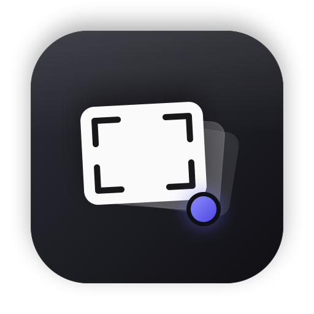

# scro



A tiny macOS menu bar tray for your screenshots (Apple Silicon, macOS 14+).

Take screenshots with the built-in macOS tools (⇧⌘3 / ⇧⌘4 / ⇧⌘5). Every new
shot is copied into scro's history automatically. Click the menu bar icon to
open the panel:

- **Preview card** of the current screenshot
- **Filmstrip** of recent shots — click a thumbnail to select it
- **‹ Prev / Next ›** to browse history (newest first, keeps the last 50)
- **Auto-copy**: every new capture goes straight to the clipboard, so ⌘V
  works immediately (detected in ~0.3–0.5s)
- **Click the preview** (or the Copy button) to copy it again — pastes as an
  image in chat/editors and as a file in Finder
- **Drag the preview** out of the panel to drop it into any app
- Folder button reveals it in Finder · trash clears history · power quits

The UI follows a shadcn-inspired design (muted surfaces, hairline borders,
ghost buttons) — see `Sources/SCRO/Views/Theme.swift`.

## Build & run

No Xcode required (uses the Swift toolchain + SwiftPM):

```sh
./scripts/bundle.sh       # builds scro.app (generates the icon on first run)
./scripts/install-app.sh  # build + install/upgrade in /Applications (one command)
```

`install-app.sh` stops the running copy, installs to `/Applications`, wires the
`scro` CLI symlink, verifies the signature, and relaunches. Use it again to
upgrade after pulling changes.

For development: `swift build` / `swift run SCRO`.

CI builds both targets on every push/PR (`.github/workflows/ci.yml`). Releases
are cut manually with `./scripts/release.sh` — see below.

## Install from a release

1. Download `scro-<version>.dmg` from **Releases** and open it
2. Drag **scro** into the **Applications** shortcut
3. First launch: **right-click → Open** — the app is ad-hoc signed, not
   notarized. If macOS reports "damaged", clear quarantine once:
   ```sh
   xattr -dr com.apple.quarantine /Applications/scro.app
   ```
4. Optional CLI (one command — links itself into `~/.local/bin/scro`):
   ```sh
   /Applications/scro.app/Contents/MacOS/scro-cli install-cli
   ```

A `scro-<version>.zip` is attached as well for scripted installs. Verify
downloads against the published `.sha256` files.

## CLI

The app bundle also contains a CLI (`scro-cli`) that shares the same capture
history — the folder is the source of truth, so the app and CLI stay in sync.

```sh
./scripts/install-cli.sh   # symlinks ~/.local/bin/scro → scro.app/.../scro-cli

scro list        # numbered list, newest first
scro copy [n]    # copy screenshot n to clipboard (default: latest)
scro path [n]    # print file path of screenshot n
scro open [n]    # reveal screenshot n in Finder
scro count       # number of captures
scro clear       # delete all captures
scro dir         # print captures directory
scro install-cli # (re)link this CLI into ~/.local/bin (for release installs)
```

## How it works

- Watches the macOS screenshot folder (`defaults read com.apple.screencapture
  location`, falling back to `~/Desktop`) with a `DispatchSource` file watcher.
  The folder is resolved **at launch** — after changing macOS's save location
  (⇧⌘5 → Options → Save to), restart scro. Saving to *Clipboard* in that panel
  writes no file, so scro can't see those shots.
- New image files are copied into
  `~/Library/Application Support/scro/captures/` (your originals are never
  touched) and auto-copied to the clipboard. History is capped at 50, oldest
  auto-deleted.
- The captures dir is watched too, so `scro clear` from the CLI updates the
  panel live. Shared logic lives in the `SCROCore` target (used by both the
  `SCRO` app and the `scro-cli` executable).
- UI is a SwiftUI `MenuBarExtra` popover; the model is an `@Observable` store.

## License

MIT — see [LICENSE](LICENSE).

## Notes

- Only screenshots taken *while scro is running* are added (history persists
  across launches).
- To start scro at login: System Settings → General → Login Items → add scro.app.
